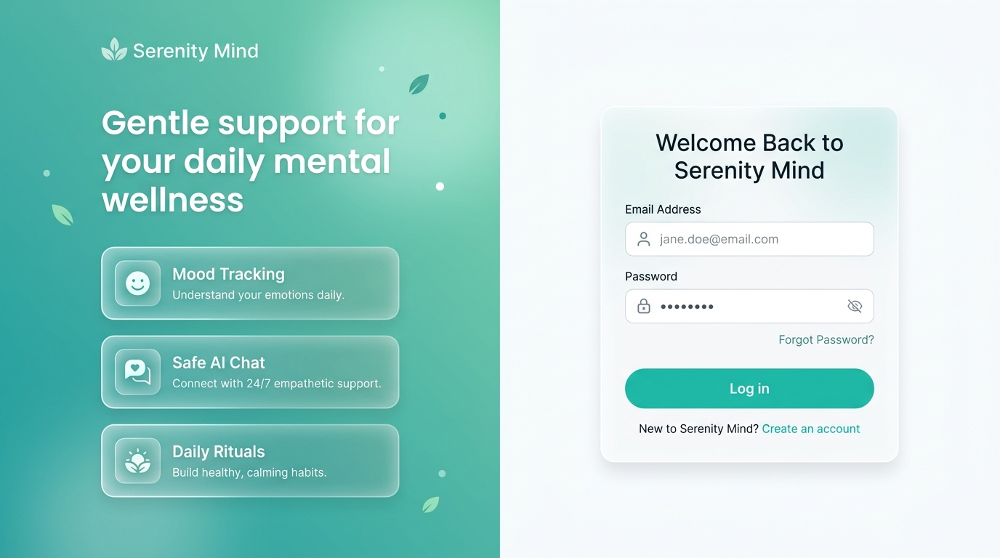
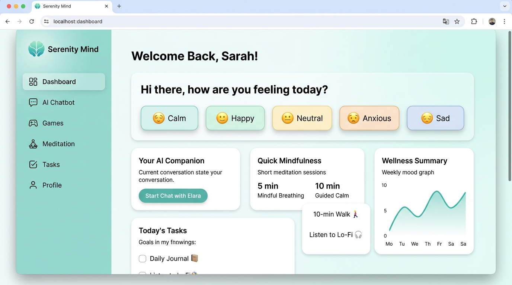
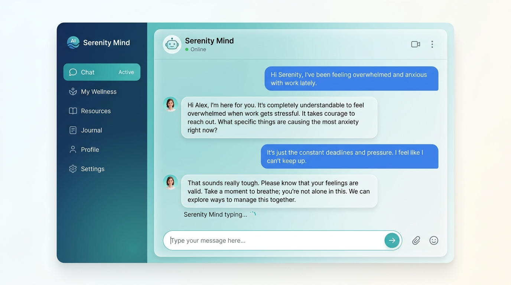
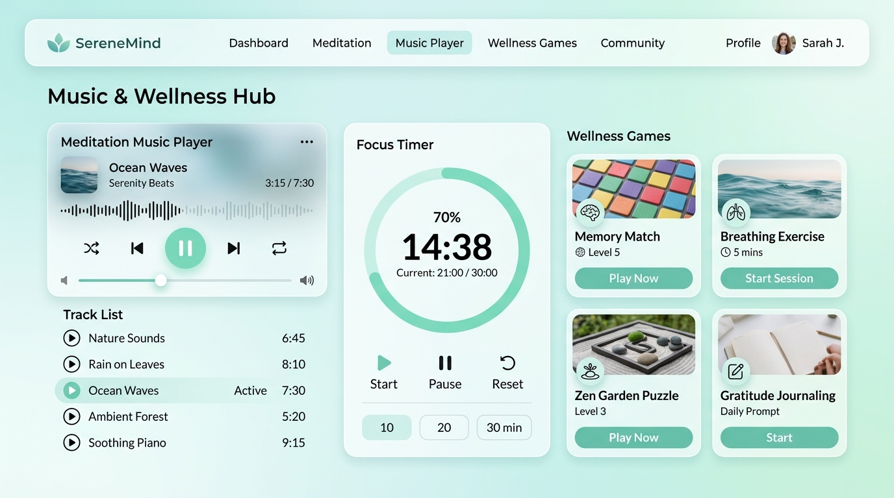
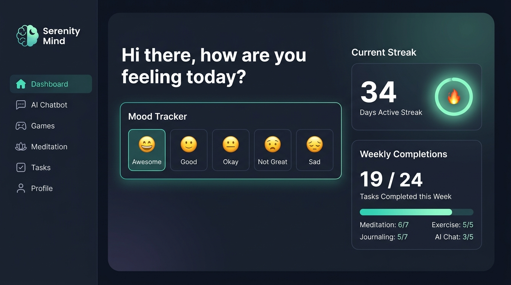

<p align="center">
  
</p>

<h1 align="center">🧠 Serenity Mind — AI Mental Health Chatbot</h1>

<p align="center">
  <strong>A full-stack AI-powered mental wellness platform for safe, empathetic support.</strong>
</p>

<p align="center">
  <a href="#features"></a>
  <a href="#tech-stack"></a>
  <a href="#tech-stack"></a>
  <a href="#tech-stack"></a>
  <a href="#tech-stack"></a>
  <a href="#tech-stack"></a>
  <a href="LICENSE"></a>
</p>

<p align="center">
  <a href="#-quick-start">Quick Start</a> •
  <a href="#-features">Features</a> •
  <a href="#-screenshots">Screenshots</a> •
  <a href="#-architecture">Architecture</a> •
  <a href="#-api-reference">API Reference</a> •
  <a href="#-contributing">Contributing</a>
</p>

---

## 📸 Screenshots

<details>
<summary><strong>🖥️ Click to expand all screenshots</strong></summary>

### Dashboard — Light Mode


### AI Chatbot Conversation


### Meditation Music, Focus Timer & Wellness Games


### Dashboard — Dark Mode


</details>

---

## ✨ Features

| Feature | Description |
|---------|-------------|
| 🤖 **AI Mental Health Chatbot** | Empathetic, context-aware conversations powered by **Google Gemini 2.5 Flash** with crisis detection and off-topic filtering |
| 📊 **Mood Tracking** | One-tap emotional check-ins with emoji-based moods and 7-day trend visualization |
| 🎮 **Wellness Games** | Memory Match, Color Match, and 4-7-8 Breathing Exercise games to promote relaxation |
| 🎵 **Meditation Music** | Curated relaxation audio tracks with a built-in focus timer (10/20/30 min presets) |
| ✅ **Daily Wellbeing Tasks** | Auto-seeded daily wellness tasks with streak tracking and weekly progress stats |
| 🔐 **JWT Authentication** | Secure access + refresh token flow with password hashing (bcrypt) |
| 🌙 **Light & Dark Themes** | Beautiful glassmorphism UI with smooth theme transitions |
| 🛡️ **Crisis Safety Net** | Automatic crisis keyword detection with immediate helpline resources (988, Samaritans, etc.) |
| 📱 **Fully Responsive** | Mobile-first design that works beautifully on all screen sizes |
| 🔄 **Offline Demo Mode** | Frontend works without backend using localStorage simulation |

---

## 🏗️ Architecture

```
┌─────────────────────────────────────────────────────┐
│                    Frontend (React 19)              │
│  ┌──────────┐ ┌──────────┐ ┌──────────┐ ┌────────┐ │
│  │Dashboard │ │ Chatbot  │ │  Games   │ │ Music  │ │
│  └────┬─────┘ └────┬─────┘ └────┬─────┘ └───┬────┘ │
│       └─────────────┼───────────┼────────────┘      │
│              Axios + JWT Interceptor                │
│              Demo Fallback (localStorage)           │
└──────────────────────┬──────────────────────────────┘
                       │ REST API
┌──────────────────────┴──────────────────────────────┐
│                   Backend (FastAPI)                  │
│  ┌──────────┐ ┌──────────────┐ ┌──────────────────┐ │
│  │  Auth    │ │  AI Service  │ │  CRUD Endpoints  │ │
│  │  (JWT)   │ │  (Gemini AI) │ │  (Mood/Tasks/    │ │
│  │          │ │  + Fallback  │ │   Games/Music)   │ │
│  └────┬─────┘ └──────┬───────┘ └────────┬─────────┘ │
│       └──────────────┼──────────────────┘            │
│              SQLAlchemy 2.0 ORM                     │
└──────────────────────┬──────────────────────────────┘
                       │
              ┌────────┴────────┐
              │  SQLite / PostgreSQL  │
              └─────────────────┘
```

---

## 🛠️ Tech Stack

### Frontend
| Technology | Purpose |
|-----------|---------|
| **React 19** | UI framework with hooks & context |
| **TypeScript** | Type-safe development |
| **Vite 7** | Lightning-fast build tooling |
| **Tailwind CSS 4** | Utility-first styling with custom design system |
| **React Router 7** | Client-side SPA routing |
| **Axios** | HTTP client with interceptors |

### Backend
| Technology | Purpose |
|-----------|---------|
| **FastAPI** | High-performance async Python API |
| **SQLAlchemy 2.0** | ORM with async support |
| **SQLite** | Zero-config local database (swappable to PostgreSQL) |
| **Python-Jose** | JWT token generation & validation |
| **Passlib + bcrypt** | Secure password hashing |
| **Google Gemini API** | Cloud AI for empathetic chat responses |

### AI Pipeline
| Layer | Technology | When Used |
|-------|-----------|-----------|
| **Crisis Detection** | Regex pattern matching | Always (first check) |
| **Cloud AI** | Google Gemini 2.5 Flash | When `GEMINI_API_KEY` is set |
| **Local ML** | HuggingFace Transformers (DialoGPT) | When model files are available |
| **Heuristic Fallback** | Keyword-based empathetic responses | Default when no AI is configured |

---

## 🚀 Quick Start

### Prerequisites

- **Node.js** 18+ and **npm**
- **Python** 3.10+
- (Optional) **Google Gemini API key** for AI chat

### 1. Clone the Repository

```bash
git clone https://github.com/Tinexit/ai-mental-health-chatbot.git
cd ai-mental-health-chatbot
```

### 2. Frontend Setup

```bash
npm install
npm run dev
```

The frontend runs at `http://localhost:5173` and includes a **demo mode** that works without the backend.

### 3. Backend Setup

```bash
# Create virtual environment
python -m venv .venv

# Activate it
# Windows:
.venv\Scripts\activate
# macOS/Linux:
source .venv/bin/activate

# Install dependencies
pip install -r requirements.txt
```

### 4. Configure Environment

```bash
cp .env.example .env
```

Edit `.env` with your settings:

```env
DATABASE_URL=sqlite:///./serenity_mind.db
JWT_SECRET=replace-with-a-long-random-secret
JWT_ALGORITHM=HS256
ACCESS_TOKEN_MINUTES=30
REFRESH_TOKEN_DAYS=7
FRONTEND_ORIGINS=http://localhost:5173,http://127.0.0.1:5173
VITE_API_BASE_URL=http://localhost:8000

# Optional — enables AI-powered chat responses
GEMINI_API_KEY=your-gemini-api-key-here
GEMINI_MODEL=gemini-2.5-flash
```

### 5. Start the Backend

```bash
uvicorn backend.main:app --reload --port 8000
```

### 6. Open the App

Visit `http://localhost:5173` — create an account and start exploring! 🎉

---

## 📡 API Reference

### Authentication
| Method | Endpoint | Description |
|--------|----------|-------------|
| `POST` | `/api/auth/register` | Create a new account |
| `POST` | `/api/auth/login` | Sign in and receive JWT tokens |
| `POST` | `/api/auth/refresh` | Refresh access token |

### User Profile
| Method | Endpoint | Description |
|--------|----------|-------------|
| `GET` | `/api/user/profile` | Get current user profile |
| `PUT` | `/api/user/profile` | Update name/email |
| `PUT` | `/api/user/password` | Change password |
| `DELETE` | `/api/user` | Delete account permanently |

### Chat
| Method | Endpoint | Description |
|--------|----------|-------------|
| `GET` | `/api/chat/history?page=1&limit=50` | Paginated chat history |
| `POST` | `/api/chat/message` | Send message to AI chatbot |

### Mood Tracking
| Method | Endpoint | Description |
|--------|----------|-------------|
| `POST` | `/api/mood` | Log a mood entry |
| `GET` | `/api/mood/history?days=7` | Get mood history |

### Wellness Games
| Method | Endpoint | Description |
|--------|----------|-------------|
| `POST` | `/api/games/session` | Save a game session |
| `GET` | `/api/games/stats` | Get game statistics |

### Music & Tasks
| Method | Endpoint | Description |
|--------|----------|-------------|
| `GET` | `/api/music/tracks` | List meditation tracks |
| `GET` | `/api/tasks` | Get today's tasks |
| `POST` | `/api/tasks` | Create a custom task |
| `PUT` | `/api/tasks/{id}/toggle` | Toggle task completion |
| `GET` | `/api/tasks/stats` | Get streak & weekly progress |

---

## 📁 Project Structure

```
ai-mental-health-chatbot/
├── src/                          # React frontend
│   ├── App.tsx                   # Main app with all pages & routing
│   ├── lib/api.ts                # API client, auth, demo fallback
│   ├── utils/cn.ts               # Tailwind class merge utility
│   ├── index.css                 # Design system & theme variables
│   └── main.tsx                  # App entry point
├── backend/                      # FastAPI backend
│   ├── main.py                   # API routes, models, auth, DB
│   ├── ai_service.py             # AI pipeline (Gemini + fallback)
│   └── __init__.py
├── api/                          # Vercel serverless entry
├── public/                       # Static assets
├── scripts/                      # Build scripts
│   └── vercel-build.mjs          # Vercel deployment build
├── docs/images/                  # README screenshots
├── .env.example                  # Environment variable template
├── requirements.txt              # Python dependencies
├── package.json                  # Node.js dependencies
├── vite.config.ts                # Vite configuration
├── vercel.json                   # Vercel deployment config
├── tsconfig.json                 # TypeScript configuration
└── README.md                     # This file
```

---

## 🌐 Deployment

### Vercel (Recommended)

This project is pre-configured for **Vercel** with full-stack deployment:

1. Push your code to GitHub
2. Import the repo in [Vercel](https://vercel.com)
3. Set environment variables in Vercel dashboard
4. Deploy! ✨

The `vercel.json` handles:
- FastAPI serverless backend
- Vite static frontend build
- SPA routing rewrites

### Manual Deployment

Build the frontend:
```bash
npm run build
```

Run the backend in production:
```bash
uvicorn backend.main:app --host 0.0.0.0 --port 8000
```

---

## 🧠 AI Model Configuration

### Cloud AI (Recommended)
Set `GEMINI_API_KEY` in `.env` to enable Google Gemini-powered responses. No model files needed.

### Local ML Models (Optional)
Train and export custom models for fully offline AI:

1. **Intent Classifier** — Fine-tuned DistilBERT for `mental_health` vs `off_topic` classification
2. **Response Model** — Fine-tuned DialoGPT-medium for empathetic mental health dialogue

Place model directories at:
```env
INTENT_MODEL_PATH=./models/intent_classifier
CHAT_MODEL_PATH=./models/mental_health_dialogpt
```

### Recommended Training Data
- [CounselChat](https://github.com/nbertagnolli/counsel-chat)
- [ESConv](https://github.com/thu-coai/Emotional-Support-Conversation)
- DailyDialog
- HOPE / Empathetic Support datasets

---

## 🤝 Contributing

Contributions are welcome! Here's how:

1. **Fork** this repository
2. **Create** a feature branch: `git checkout -b feature/amazing-feature`
3. **Commit** your changes: `git commit -m 'Add amazing feature'`
4. **Push** to the branch: `git push origin feature/amazing-feature`
5. **Open** a Pull Request

---

## 📄 License

This project is licensed under the **MIT License** — see the [LICENSE](LICENSE) file for details.

---

## ⚠️ Disclaimer

> **Serenity Mind is not a substitute for professional mental health care.** It is designed as a supportive wellness tool. If you or someone you know is in crisis, please contact your local emergency services or a crisis helpline:
>
> - 🇺🇸 **USA/Canada**: Call or text **988**
> - 🇬🇧 **UK**: Samaritans — **116 123**
> - 🇦🇺 **Australia**: Lifeline — **13 11 14**
> - 🇮🇳 **India**: Tele-MANAS — **14416**

---

<p align="center">
  Made with 💚 for mental wellness
  <br>
  <strong>Serenity Mind</strong> — Your gentle companion for daily balance.
</p>
